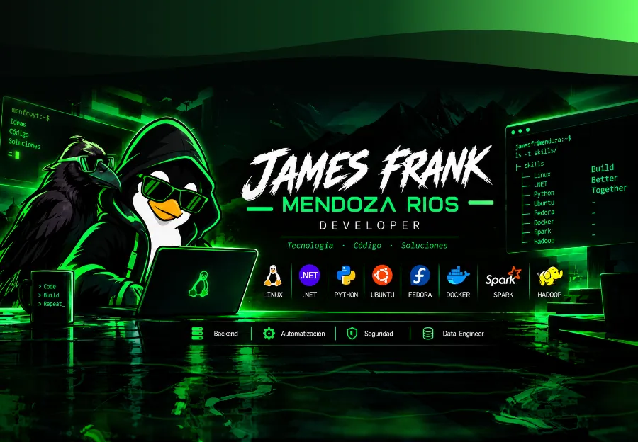

  

  <h1>James Frank Mendoza Ríos</h1>

  

    

  

  

    Desarrollador de software enfocado en APIs REST, arquitectura limpia y soluciones escalables. 
    Construyo soluciones completas de Backend y Frontend, desplegadas en entornos Cloud.
  

  

    
    
    
  

- Estudiante de **Ingeniería de Tecnologías de Información y Sistemas** en la Universidad ESAN.
- Experiencia con **.NET Core, Node.js, FastAPI y Angular**.
- Despliegue de aplicaciones con **Docker, AWS y Microsoft Azure**.
- Interesado en arquitectura de software, buenas prácticas y sistemas escalables.

| Año  | Reconocimiento                                   |
| ---- | ------------------------------------------------ |
| 2025 | **2.º puesto** — Hackathon PRODUCE CIRCULAR      |
| 2025 | **2.º puesto** — Proyectos Móviles NTTDATA       |

<table align="center">
  <thead>
    <tr>
      <th align="center"><b>Lenguajes</b></th>
      <th align="center"><b>Backend y APIs</b></th>
      <th align="center"><b>Frontend</b></th>
      <th align="center"><b>Móvil</b></th>
      <th align="center"><b>Bases de datos</b></th>
      <th align="center"><b>Cloud y DevOps</b></th>
      <th align="center"><b>Herramientas</b></th>
    </tr>
  </thead>
  <tbody>
    <tr>
      <td align="center" valign="top">
        
        
        
        
        
      </td>
      <td align="center" valign="top">
        
        
        
        
        
        
      </td>
      <td align="center" valign="top">
        
        
        
        
        
        
      </td>
      <td align="center" valign="top">
        
        
      </td>
      <td align="center" valign="top">
        
        
        
        
        
        
      </td>
      <td align="center" valign="top">
        
        
        
        
        
        
      </td>
      <td align="center" valign="top">
        
        
        
        
        
        
        
        
        
      </td>
    </tr>
  </tbody>
</table>

  

    

  <picture>
    <source media="(prefers-color-scheme: dark)" srcset="https://raw.githubusercontent.com/james250920/james250920/output/github-snake-dark.svg">
    <source media="(prefers-color-scheme: light)" srcset="https://raw.githubusercontent.com/james250920/james250920/output/github-snake.svg">
    
  </picture>

    

  

